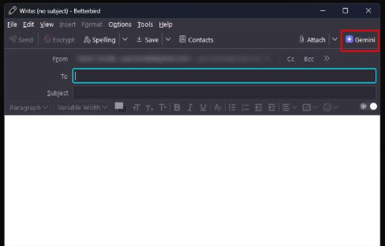
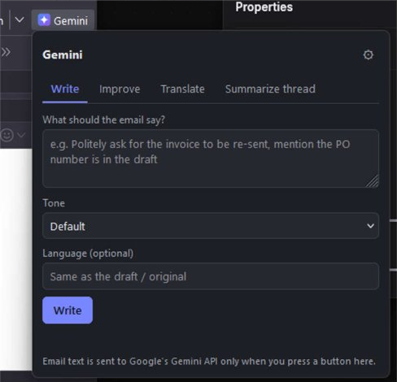
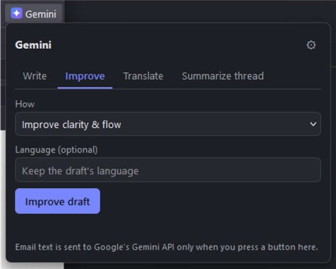
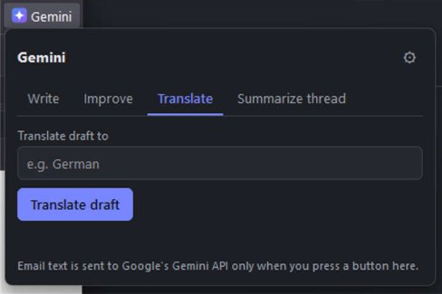
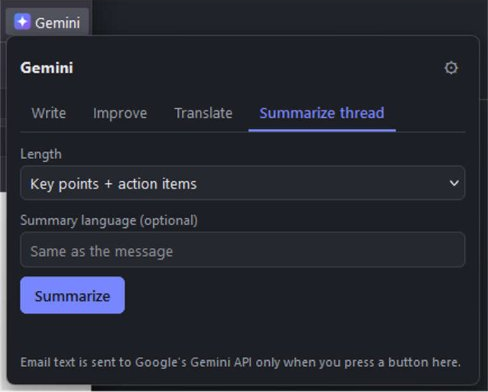
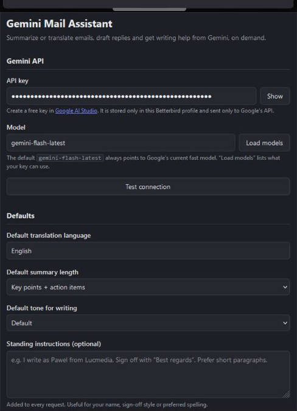

# Gemini Mail Assistant

Betterbird / Thunderbird extension that calls the Google Gemini API **on demand** to:

**While reading an email** (toolbar button "Gemini" in the message header bar)
- Summarize (short / key points + action items / detailed)
- Translate to any language
- Draft a reply (opens a reply window with the text inserted above the quote)
- Ask a question about the email

**While writing an email** (toolbar button "Gemini" in the compose window)
- Write an email from your instructions (uses your draft and the original message as context)
- Improve the draft (fix grammar, clarity, shorter, more formal/friendly/professional)
- Translate the draft
- Summarize the thread you are replying to

Results appear in an editable box. Copy them, or insert them into the email (Insert / Replace draft). Replace only touches your own text, never the quoted message or signature.

## Screenshots

**The "Gemini" button in the compose toolbar**

**Compose: Write, Improve, Translate, Summarize thread**

| Write | Improve |
|---|---|
|  |  |

| Translate | Summarize thread |
|---|---|
|  |  |

**Settings**

## Install

1. Betterbird: Menu > Add-ons and Themes > gear icon > *Install Add-on From File…* > choose `gemini-mail-assistant-1.0.0.xpi`.
2. Open the add-on's settings, paste a Gemini API key from https://aistudio.google.com/apikey, press *Test connection*, then *Save*.
3. If the "Gemini" button is not visible: right-click the toolbar > *Customize…* and drag it in (message header bar for reading, compose toolbar for writing).

For development: *Add-ons > Debug Add-ons > Load Temporary Add-on…* and pick `manifest.json`.

## Notes

- Requires Betterbird / Thunderbird 128 or newer.
- Default model is `gemini-flash-latest` (always the current fast model). Use *Load models* in settings to pick another one.
- Nothing is sent to Google until you press a button. The email text (and, in replies, the original message) is sent with your API key. The free API tier may use content to improve Google products; use a paid key for confidential mail.
- Standing instructions in settings (your name, sign-off, spelling) are added to every request.
- Compose cannot see the text you have selected in the editor (no MailExtension API for it), so actions work on your whole draft text.

## Files

- `manifest.json` – MV2 manifest, ID `gemini-assistant@lucmedia.pl`
- `background.js` – message handling, sessions (a result survives closing the popup)
- `lib/gemini.js` – Gemini REST client, `lib/prompts.js` – prompt builder
- `lib/mail.js` – message text extraction, draft/quote/signature splitting, insertion
- `popup/` – reading and compose popups, `options/` – settings page
